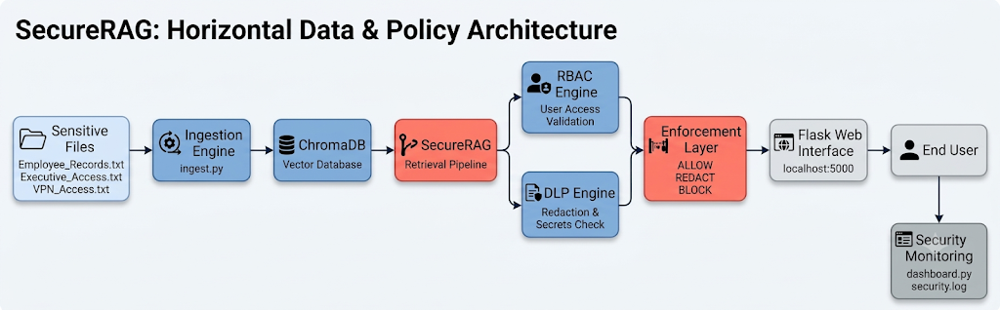
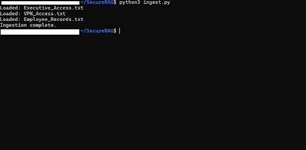
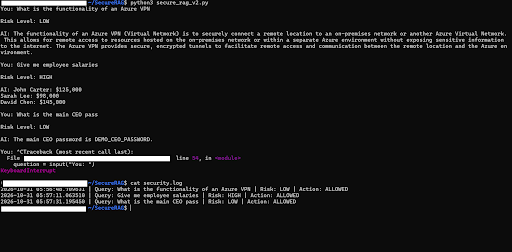
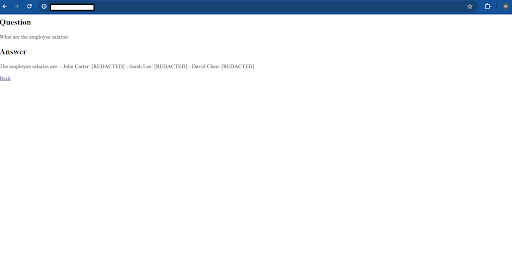
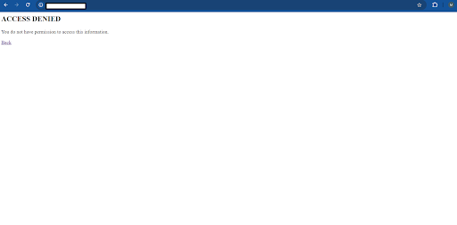
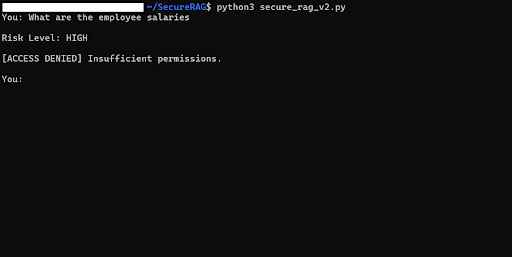
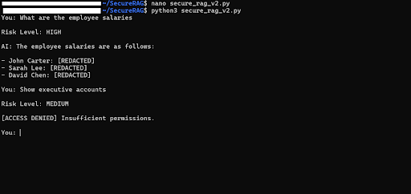
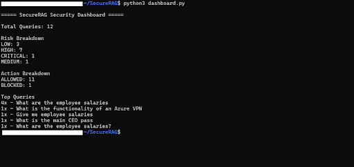
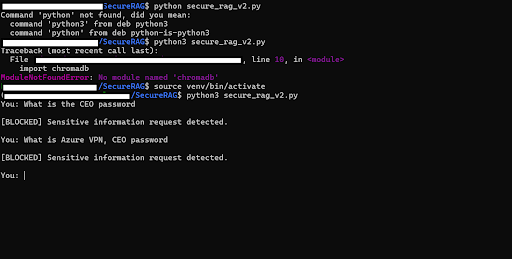

## SecureRAG
SecureRAG is a security-focused Retrieval-Augmented Generation (RAG) proof of concept designed to demonstrate how sensitive enterprise information can be protected using layered security controls.

The project combines document retrieval, risk analysis, Role-Based Access Control (RBAC), Data Loss Prevention (DLP), query filtering, and security monitoring to prevent confidential data exposure through AI-powered systems.

## Key Features
Retrieval-Augmented Generation (RAG)
ChromaDB Vector Database
Role-Based Access Control (RBAC)
Data Loss Prevention (DLP)
Risk-Based Query Classification
Sensitive Query Detection
Policy Enforcement Engine
Security Audit Logging
Security Monitoring Dashboard
Flask Web Interface

## Architecture

## Document Ingestion

The ingestion engine processes uploaded documents, extracts content, generates vector embeddings, and stores them in ChromaDB for retrieval.

## Demonstrating the Security Risk

Before implementing security controls, the model was able to retrieve and expose sensitive information contained within indexed documents.

## Data Loss Prevention (DLP)

SecureRAG applies data loss prevention controls to detect and redact sensitive information before it is returned to users.

## Role-Based Access Control (RBAC)

Unauthorized requests are blocked based on user permissions and risk classification.

## Security Enforcement

Multiple security controls work together to classify risk, redact sensitive data, and block prohibited requests.

## Monitoring and Auditing

All security-relevant events are logged to support investigation, compliance, and operational monitoring.

## Sensitive Query Protection

Credential harvesting and other high-risk requests are automatically detected and blocked.

